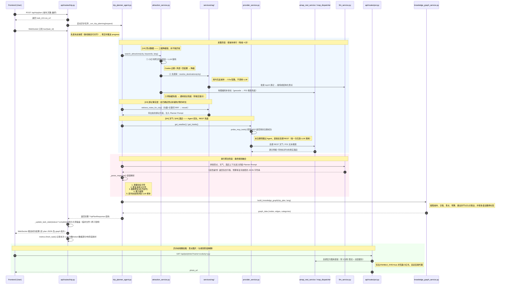

<div align="center" style="display: flex; justify-content: center; align-items: center; gap: 2px;">
  
</div>
<p align="center">
  
  
  
  
  
  
</p>

<div align="center">

[🇨🇳 中文](README.md) | [🇺🇸 English](README_en.md) | [🇯🇵 日本語](README_ja.md)


# 旅途星辰 - AI 旅行智能体
**基于 HelloAgents 框架打造的多智能体协作文旅规划平台**
</div>


> [!IMPORTANT]
> 
> 本地部署可直接体验项目，完整体验项目功能需配置好相关的key，探索丰富功能， 
> 其中包括：旅行计划、景点地图概览、预算明细、每日行程：行程描述、交通方式、住宿推荐、景点安排（地址、游览时长、景点描述、预约提醒）、餐饮安排、天气信息、知识图谱可视化、沉浸式伴游 AI 问答......

## 项目简介

**旅途星辰 (TripStar)** 是一个创新的 AI 文旅智能体应用，基于 HelloAgents 框架打造的多智能体协作文旅规划平台，旨在解决用户在规划旅行时面临的"信息过载"和"决策疲劳"问题。

有别于传统的旅游攻略网站，本项目采用了基于 **大语言模型 (LLM)** 和 **多智能体 (Multi-Agent)** 协作架构的创新模式。它能像一位经验丰富的人类旅行管家一样，全面考虑用户的个性化需求（偏好设置：交通方式、住宿风格、旅行兴趣、特殊需求等），自动搜索旅行信息、查询当地天气、精选酒店并规划最优景点路线，以**快速完成旅游攻略**。

### 核心亮点

* **数据源三级降级链（永不失败的采集）**: 景点数据按「小红书实时搜索 → 本地 RAG 知识库 → 通用常识」逐级降级，整条链**永不抛异常**；天气/酒店按「Agent 调工具 → 高德 REST 直连」降级；坐标按「高德地理编码 → POI 搜索」降级。**每级降级都在进度条与注入 LLM 的上下文中标注来源**，模型因此会主动提示「门票与预约请自行核实」，而不是假装数据是实时的。
* **本地 RAG 知识库（混合检索 + 双用途）**: ChromaDB + BGE-M3 向量，检索链路为「向量 + 关键词 RRF 融合 → 社区热度破平局 → rerank 精排 → 按 post_id 去重 → 权威底库兜底」。**同一份知识库有两种用法**：小红书可用时作「事实层」补充避坑/预约信息，不可用时直接作「数据源」挖出结构化景点。附带完整灌库管线与元数据契约（`backend/scripts/ingest_yunnan.py`）。
* **小红书深度集成（可选数据源）**: 通过签名引擎原生直连，将真实用户游记经 LLM 智能提纯为结构化景点，获取最真实的避坑指南与预约信息。**未配置 Cookie 时自动降级到本地知识库**，不影响应用可用性。
* **景点预约提醒**: 智能识别游记中提及的需要提前预约的景点（如故宫、陕西历史博物馆等），在行程卡片中醒目标注预约提示与预约渠道信息，防止白跑一趟。
* **多语言与国际化支持**: 深度集成 Vue I18n，同时在 LLM 提示词层及知识图谱底层实现语言自适应适配。系统界面及 AI 问答全程支持多语言（中/英/日）无缝切换，连同生成的旅行规划数据会自动翻译为目标语言。景点同时保存中英双名称字段，供高德/Google 分别做地理编码。
* **双地图引擎高定互动展现**: 深度集成并支持 **Google Maps** 与 **高德地图 (AMap)** 双引擎的无缝切换与自动回退。国外使用 Google Maps，国内回退高德。动态绘制"起点-景点-终点"的真实经纬度打卡路线，提供高级定制底图配色，一眼预览景点位置方便安排行程。
* **精准预算明细面板**: 智能汇总门票、餐饮、住宿与交通等多维度花销账单，提供直观的财务面板报表，让出行预算尽在掌握。
* **多智能体协作协同**: 采用分工明确的多个 Agent（天气查询专家、酒店推荐专家、行程规划专家），其中工具型 Agent 走文本协议 ReAct 循环；整体为确定性的 Agentic Workflow 编排。
* **知识图谱可视化**: 将生成的行程数据实时转换为节点关系图，直观展示"城市-天数-行程节点-预算"的空间结构。
* **沉浸式伴游 AI 问答**: 在生成报告后，提供悬浮式 AI 问答窗口（左下角），AI 拥有完整行程的上下文记忆，用户可随时针对行程细节（如票价、适宜性）进行追问。
* **多城市行程规划**: 支持在一次旅行中规划多个城市，动态添加城市并设置停留天数，系统自动计算总行程天数。城际移动日智能标注交通建议，预算面板独立统计城际交通费用，天气面板按城市分别展示，知识图谱以多城市拓扑呈现完整路线。
* **用户偏好记忆模块**: 内置分权重的用户专属旅行偏好记忆库，支持遗忘机制与 TOP-K 召回。开启后会在行程生成成功后自动提取稳定偏好并打分入库，下次规划时将高权重偏好注入 Agent Prompt，让推荐持续贴合用户习惯。
* **结构化输出的多级容错**: 针对 LLM 长 JSON 易损坏的问题，实现「清洗 → 修引号 → 截断修复 → 正则提取 → LLM 修补」多级容错解析；截断修复采用「逐段剥离 + 每次试解析」策略，缺失必填字段时补安全默认值；彻底失败时返回**不编造内容**的兜底骨架。
* **可观测性**: `GET /api/trip/metrics` 导出运行指标（LLM 调用次数/token、数据源与降级分布、JSON 修复命中、各阶段耗时），用于建立优化基线。
* **奢华暗黑玻璃拟物风**: 全新设计的暗黑系玻璃拟物化 (Dark Luxury Glassmorphism) 界面，提供极具沉浸感的高级视觉体验。
---
> 举个例子：到中国——西安玩耍，只需要填写地点、日期、偏好设置，即可等待行程规划的结果，一眼预览如何安排旅游景点（步行路线、驾车路线等）


## 系统架构

本项目采用标准的前后端分离架构，分为前端 Vue 交互层、后端 FastAPI 服务层和 LLM/Agents 的智能推理层。



---

## 核心功能与工作流

### 1. 异步任务 + WebSocket 状态机 (解决网关超时)

针对 LLM 生成超长文本易导致 504 Gateway Timeout 的痛点，后端采用任务化调度：

* **`POST /api/trip/plan`**: 立即返回 `task_id`，将长达数分钟的推理任务推入后台 `asyncio.create_task`。
* **`WS /api/trip/ws/{task_id}`**: 主通道。连上先发**状态快照**，因此刷新页面/断线重连都能立刻对齐进度；仅已完成/已失败时才直接关闭。
* **`GET /api/trip/status/{task_id}`**: 轮询兼容通道（部分代理会掐断 WS 长连接）。
* **重启语义**: 服务重启后，磁盘中非终态任务直接标记为 `failed`，避免前端无限等待。
* **结果缓存**: 结果同时写入 sessionStorage（刷新零请求）与磁盘 JSON（换设备可回捞），结果页三级回补。
* **`GET /api/trip/metrics`**: 导出运行指标，用于建立性能与成本基线。

### 2. 数据源降级链 (核心健壮性设计)

外部数据源不稳定是这类应用最大的工程风险。**任何外部依赖都有兜底，且兜底必须显式可观测**：

| 数据 | 优先级 | 兜底 | 失败后果 |
|---|---|---|---|
| **景点** | ① 小红书实时搜索 → ② 本地 RAG 知识库 → ③ 通用常识 | 三级，永不抛异常 | 无（最差为带核实提示的通用建议） |
| **天气** | ① Agent 调 MCP 工具 → ② 高德 REST 预报 | 二级 | 明确告知「无预报」，禁止编造温度 |
| **酒店** | ① Agent 调 MCP 工具 → ② 高德 POI 文本搜索 | 二级 | 明确告知不可用，禁止编造名称价格 |
| **坐标** | ① 高德地理编码 → ② 高德 POI 搜索（LCS 名称匹配） | 二级 | 允许 `location=null`，**严禁照抄其他景点坐标** |

几个关键取舍：

* **先探库再调 LLM**：知识库无该城市时 `resolve_destinations()` 直接短路（实测 0.5s），不做注定失败的提纯调用。
* **启动期主动探测 MCP**：`probe_mcp_tools()` 判断工具是否真的展开注册；未就绪则跳过 Agent 直接走 REST，省掉「一次无效 LLM 调用 + 一次错误文案回合」。
* **天气时效性校验**：高德仅提供未来数天预报，与行程日期不重叠时**不注入任何温度**，只允许定性季节建议。
* **降级必须可见**：进度条显示走了哪条路，注入 Prompt 的上下文也标注来源（如「景点信息（来源：本地知识库，非实时数据）」），模型因此会主动提示用户自行核实。

### 3. RAG 检索 (混合检索 + 双用途)

知识库为 ChromaDB（BGE-M3 向量，1024 维），检索链路：

```
向量检索 ┐
         ├─ RRF 融合(Σ1/(60+rank)) → 社区热度破平局 → rerank 精排 → 按 post_id 去重 → 权威底库兜底
关键词检索 ┘
```

* **热度只破平局**：RRF 分量化到 `0.0002` 桶，桶内才按热度排序——保证相关性主导，热度仅在相关性相近时生效。
* **精排是增强项**：rerank 失败自动降级回 RRF 结果，不阻塞主流程。
* **双用途**：既作「事实层」给已确定景点补避坑/预约信息，也作「数据源」在小红书不可用时直接挖出结构化景点。
* **灌库契约**：`destination` 必须归一化为「云南X」格式（否则按城市过滤永远查不到）；`post_id` 必须唯一正整数（否则去重退化为按 chunk 去重）；灌完须清目的地缓存。详见 `backend/scripts/ingest_yunnan.py`。

### 4. 多智能体架构 (Agentic Workflow)

* **天气查询专家 / 酒店推荐专家**：真 Agent（SimpleAgent + 工具），采用**文本协议 ReAct**（`[TOOL_CALL:工具名:key=value]` + 正则解析 + 工具结果回注循环，最多 3 轮）。
* **行程规划专家**：无工具，接收聚合上下文一次性产出完整 JSON。**注意其编排是确定性 for 循环而非自主决策**，准确表述是「Agentic Workflow」而非「自主 Agent」。
* **景点提取**：由 LLM 把游记正文提纯为结构化景点（`name_zh`/`name_en` 双字段供高德/Google 分别编码），再补坐标。
* **结果聚合**：输出含预算明细、逐日行程、预约提醒、防坑指南的结构化 JSON，并经五级容错解析（清洗 → 修引号 → 截断修复 → 正则提取 → LLM 修补），失败时返回**不编造内容**的兜底骨架。

### 5. 数据驱动的动态组件渲染

前端不再是写死的静态展示，而是通过响应式变量读取 JSON 数据：

* **高德地图 JS API 2.0 组件**: 动态读取 POI 经纬度，绘制连线与标记。
* **ECharts 知识图谱组件**: 将树状的旅行层级转化为关系网络（图数据库雏形）。

---

## 快速部署与运行指北

### 环境准备

* Python 3.10+
* Node.js 18+
* 大模型 API Key（推荐使用兼容 OpenAI 格式的服务商，如豆包）
* 高德地图两种 Key：Web 服务 Key（后端 REST 服务）与 Web端(JS API) Key（前端地图渲染）。AMap JS API 2.0 的安全密钥 JSCode 仍然必须填写，但填写到 `.env` / Docker 根目录 `.env` 的 `VITE_AMAP_SECURITY_JS_CODE`，构建或启动前端开发服务时会自动替换 `index.html` 里的占位符，不要把真实密钥直接手写进 `index.html`。（[高德 API](https://lbs.amap.com/)）
* [Google Maps API Key](https://developers.google.com/maps/apis-by-platform)（若要使用 Google 地图引擎，必须在 Google Cloud 控制台中开通：**Geocoding API, Places API (New), Directions API, Maps JavaScript API, Weather API**，需要绑卡）
* 小红书Cookie（可选，[小红书](https://www.xiaohongshu.com/) 网页端登录后从浏览器开发者工具复制；不配置则景点数据自动降级到本地知识库）
* 硅基流动 API Key（可选，用于 RAG 本地知识库的 Embedding 与 Rerank；[申请地址](https://cloud.siliconflow.cn)）
* 安装 `uv` 包管理器

### Docker / Compose 配置约定

推荐通过 docker-compose 一键启动项目（包含前端和后端环境），在运行之前，先复制根目录配置模板并填补 `.env` 里的环境变量：

```bash
cp .env.example .env
```

* 容器启动时不再读取项目目录里的 `backend/.env`，请确保将配置以环境变量的形式传入。
* `docker-compose.yaml` 中显式配置了必要的运行时代理和 API keys，支持传入 `GOOGLE_MAPS_API_KEY` 与 `GOOGLE_MAPS_PROXY` 等变量；其中 `GOOGLE_MAPS_PROXY` 只用于后端 Google Maps 服务，不会影响 LLM、小红书或高德请求。
* RAG 相关变量（`EMBEDDING_API_KEY` / `EMBEDDING_MODEL` / `RERANK_*`）同样通过环境变量传入。**注意 `EMBEDDING_MODEL` 必须与建库时一致**，否则已有向量失效。
* 运行时数据统一挂在命名卷 `trip_data` → `/app/backend/data`，因此**知识库向量（chroma）、任务 JSON、图片缓存在容器重建后不会丢失**。若要在容器内灌库，请把素材挂进容器后执行 `python backend/scripts/ingest_yunnan.py <目录>`；也可以先在宿主机灌好再挂载。
* 前端构建期变量 `VITE_AMAP_WEB_JS_KEY` 与 `VITE_AMAP_SECURITY_JS_CODE` 会通过 `build.args` 自动注入前端；修改后需要重新构建镜像。
* 前端设置页可修改后端运行时配置（LLM、小红书、高德 Web 服务 Key、Google Maps Key/代理等）。敏感字段会被遮罩返回，保存遮罩值时后端会保持原密钥不变。

根目录 `.env` 示例：

```env
LLM_API_KEY=your_api_key
LLM_BASE_URL=https://your-openai-compatible-endpoint/v1
LLM_MODEL_ID=your_model
XHS_COOKIE="a1=xxx; web_session=xxx"
VITE_AMAP_WEB_KEY=your_amap_web_service_key
VITE_AMAP_WEB_JS_KEY=your_amap_web_js_key
VITE_AMAP_SECURITY_JS_CODE=your_amap_security_js_code
EMBEDDING_API_KEY=your_siliconflow_key
EMBEDDING_BASE_URL=https://api.siliconflow.cn/v1
EMBEDDING_MODEL=BAAI/bge-m3
GOOGLE_MAPS_API_KEY=
GOOGLE_MAPS_PROXY=
```

本地开发仍可按下面步骤分别配置和启动 `backend/.env` 和 `frontend/.env`。

### 本地开发

#### 1. 后端启动

```bash
# 进入后端主目录
cd backend

# 安装小红书签名引擎的 Node.js 依赖
npm install

# 使用 uv 创建虚拟环境并安装依赖
uv venv .venv

# 激活虚拟环境
source .venv/bin/activate  # Windows: .venv\Scripts\activate

# 安装项目依赖包
uv pip install -r requirements.txt

# 复制配置文件并填入相应的 API KEY
cp .env.example .env
# [必填] LLM_API_KEY, LLM_BASE_URL, LLM_MODEL_ID（选择有结构化输出能力的模型）
# [必填] VITE_AMAP_WEB_KEY (高德地图 web服务 类型的key)
# [选填] EMBEDDING_API_KEY（硅基流动 Key，启用 RAG 本地知识库；不填则检索链路静默跳过）
# [选填] XHS_COOKIE（小红书 Cookie；不填则景点数据自动降级到本地知识库）
# [选填] GOOGLE_MAPS_API_KEY, GOOGLE_MAPS_PROXY（如果需要支持 Google 地图引擎）
#         GOOGLE_MAPS_PROXY 只作用于 Google Maps 后端服务，不影响 LLM/小红书/高德。

# 启动 FastAPI (推荐通过 uvicorn)
uvicorn app.api.main:app --host 0.0.0.0 --port 8000 --reload
```

API 启动后，您可以访问 `http://localhost:8000/docs` 查看互动文档。

> **关于必填项**：只有 LLM 与高德 Web Key 是必需的。小红书 Cookie 与
> Embedding Key 都可不填——景点数据会依次降级到本地知识库、通用常识，
> 行程依然能正常生成。

#### 1.1 灌入本地知识库（可选，推荐）

RAG 知识库需要先灌入数据才能被检索到：

```bash
# 1) 准备素材（.md 带 frontmatter / .txt / .jsonl 均可）
#    格式说明见 backend/scripts/kb_samples_format.md
#    样例素材见 backend/data/kb_samples/（仅作格式参考，请替换为自己的内容）
# 2) 先干跑，检查每篇文档识别出的目的地是否正确
python backend/scripts/ingest_yunnan.py <素材目录> --dry-run

# 3) 确认无误后正式灌入
python backend/scripts/ingest_yunnan.py <素材目录>

# 4) 查看知识库覆盖分布
python backend/scripts/kb_stats.py 20
```

**关键约束**：`destination` 会被归一化为「省+市」格式（如 `云南大理`），
写错格式会导致该城市**永远检索不到**；非白名单目的地会被直接拒绝入库。
另外 `EMBEDDING_MODEL` 必须与建库时一致，换模型会让已有向量失效。

#### 2. 前端启动

```bash
# 进入前端主目录
cd frontend

# 使用 npm (或 pnpm/yarn) 安装依赖
npm install

# 复制配置文件并填入相应的 Key
cp .env.example .env
# [必填] VITE_AMAP_WEB_JS_KEY 必须是 Web端(JS API) 类型的key
# [必填] VITE_AMAP_SECURITY_JS_CODE 为 Web端(JS API) 安全密钥 JSCode
# [可选] VITE_API_BASE_URL 默认为 http://localhost:8000；同源部署可留空

# 启动 Vite 开发服务器
npm run dev
```


---

## 目录结构与关键代码导读

```text
TripStar/
├── backend/                       # Python FastAPI 后端
│   ├── app/
│   │   ├── api/routes/            # 核心路由 (trip.py 任务调度/指标, poi.py 图片, chat.py, settings.py)
│   │   ├── agents/
│   │   │   └── trip_planner_agent.py   # 多智能体编排 + 五级 JSON 容错解析
│   │   ├── services/              # 业务逻辑封装
│   │   │   ├── attraction_service.py   # 景点三级降级链（唯一入口，永不抛异常）
│   │   │   ├── provider_service.py     # 天气/酒店调度（Agent 优先 → REST 兜底）
│   │   │   ├── amap_rest_service.py    # 高德 Web 服务直连（POI/天气/坐标兜底）
│   │   │   ├── xhs_service.py          # 小红书搜索/提纯/搜图（提纯函数与 RAG 路径共用）
│   │   │   ├── rag/                    # 本地知识库：embedding/vectorstore/rerank/retriever/ingest
│   │   │   ├── llm_service.py          # LLM 客户端封装（含按请求 timeout）
│   │   │   ├── metrics.py              # 任务级运行指标
│   │   │   └── knowledge_graph_service.py  # 知识图谱构建
│   │   └── models/                # Pydantic 类型定义 (schemas.py)
│   ├── tests/                     # pytest 单元测试（离线可跑）
│   ├── scripts/                   # 灌库与验证脚本 (ingest_yunnan.py / kb_stats.py / e2e_*)
│   ├── data/                      # 运行时数据（chroma 向量库 / 任务 JSON / 图片缓存）
│   └── .env                       # 本地开发环境变量载体（Docker 部署时不打进镜像）
│
├── frontend/                      # Vue 3 互动前端
│   ├── src/
│   │   ├── views/                 # 主路由视图 (Landing.vue 表单输入; Result.vue 路书展示)
│   │   ├── components/            # 独立复用的 UI / 背景组件
│   │   └── services/              # Axios 异步轮询及配置重试逻辑 (api.ts)
│   ├── index.html                 # 入口挂载及高德地图 SecurityKey 占位符
│   ├── .env                       # 本地前端开发环境变量（Docker 构建时忽略）
│   └── package.json
│
├── Dockerfile                     # 通用生产发布容器脚本
├── docker-compose.yaml            # 一键容器编排
└── README.md
```

### 测试

后端核心逻辑有单元测试覆盖（不依赖网络与真实 LLM，可离线反复运行）：

```bash
cd backend
.venv/Scripts/python -m pytest tests/ -q      # Windows
# 或 .venv/bin/python -m pytest tests/ -q     # Linux/macOS
```

覆盖范围：JSON 五级容错解析、混合检索融合（RRF / 热度破平局 / 名称相似度）、
知识库灌入契约（目的地归一化 / post_id / 切块 / 三种素材格式）、
LLM 适配器参数透传（含 timeout 回归）、运行指标、降级链与进度计算。

### 运行指标

```bash
curl http://localhost:8000/api/trip/metrics
```

返回最近任务的聚合与明细：LLM 调用次数/耗时/token、数据源与降级分布、
JSON 修复命中分布、各阶段耗时。**用于给优化建立基线**——
实测单城市 3 天行程约 20-24s，其中 LLM 占约 70%，外部 API（天气/酒店）各约 0.2s。

> 下面是部分运行结果，丰富的功能探索中...


## 后续优化方向
- [x] ~~接入小红书，获得高质量计划~~
- [x] ~~景点图片改为从小红书获取~~
- [x] ~~景点提前预约提示~~
- [x] ~~接入 Google Maps，实现国内外双引擎自动降级回退~~
- [x] ~~模型返回语言国际化适配及底层知识图谱多语言支持~~
- [x] ~~可查看历史计划支持，通过任务和后端持久化解决~~
- [x] ~~支持代理配置 (HTTP/SOCKS5) 以确保国内可用 Google 服务~~
- [x] ~~修改导出图片的外观，增加地图，提高可读性~~
- [x] ~~支持多城市旅行~~
- [x] ~~外部数据源三级降级链（小红书 → 本地知识库 → 通用常识）~~
- [x] ~~本地 RAG 知识库（混合检索 + rerank 精排 + 双用途）~~
- [x] ~~后端单元测试覆盖核心逻辑~~
- [x] ~~运行指标（LLM 次数/token/降级分布/阶段耗时）~~
- [ ] 多城市并行采集（当前为串行 for 循环，天气/酒店可并发）
- [ ] RAG 检索质量评估集（Recall@K / MRR）
- [ ] 预算与景点排序改为代码精确计算（当前依赖 LLM 心算）
- [ ] 多实例部署（任务状态需从进程内存迁移到 Redis）
- [ ] 添加小红书链接以及美食推荐增强
- [ ] 前端优化（Result.vue 已超 4000 行，需拆分 composables）
- [ ] 车程信息
- [ ] 服务器在线部署


## Star History

<a href="https://www.star-history.com/?repos=1sdv%2Ftripstar&type=date&legend=bottom-right">
 <picture>
   <source media="(prefers-color-scheme: dark)" srcset="https://api.star-history.com/chart?repos=1sdv/tripstar&type=date&theme=dark&legend=top-left" />
   <source media="(prefers-color-scheme: light)" srcset="https://api.star-history.com/chart?repos=1sdv/tripstar&type=date&legend=top-left" />
   
 </picture>
</a>


## 贡献者

<a href="https://github.com/1sdv/TripStar/graphs/contributors">
  
</a>


## 🙏 致谢
感谢 [linuxdo](https://linux.do/) 社区的交流、分享与反馈，让 TripStar 的迭代更高效，同时欢迎大家进群交流反馈


